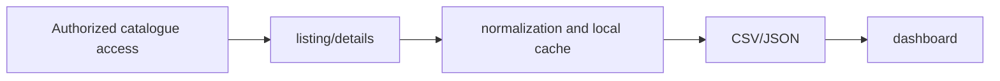

# Bounty Program Catalog

**Collect programme metadata, consolidate local exports and inspect a catalogue dashboard.**

  [](LICENSE)

[Overview](#overview) · [Quickstart](#quickstart) · [Example](#example) · [Validation](#validation) · [Documentation](#documentation)

## Overview

A Python collector that consolidates authorized bounty-program metadata into local JSON/CSV and dashboard views.

**Stack:** Python · curl-cffi · httpx · JSON/CSV · static HTML dashboard

## Collection and local inspection

| Component | Behavior |
| --- | --- |
| Collect | Listing/detail collection captures programme metadata from the configured source. |
| Consolidate | Local JSON/CSV exports provide a reusable catalogue. |
| Inspect | A generated static dashboard presents collected records. |

## Processing path



## Quickstart

```console
python -m venv .venv
# Activate .venv, then:
python -m pip install -r requirements.txt
python -m py_compile scrape_hackenproof.py build_dashboard.py wallet_finder.py
```

The commands above install prerequisites or run the specified offline checks. Live collection, cloud operations, messaging and trading are separate operational steps when present.

## Example

**Inspect the workflow**

Start with synthetic catalogue data when changing dashboard presentation. Keep source records separate from derived summaries: collection produces local data, consolidation rebuilds exports, and the dashboard displays that result. The syntax-check command does not authenticate or collect data.

## Configuration and storage

The collector uses session-dependent upstream access. Supply account/session configuration locally, inspect source expectations and keep downloaded records out of shared examples.

## Repository guide

| Location | Responsibility |
| --- | --- |
| [scrape_hackenproof.py](scrape_hackenproof.py) | Listing/detail collector |
| [build_dashboard.py](build_dashboard.py) | Dashboard generator |
| [dashboard.html](dashboard.html) | Static catalogue interface |
| [requirements.txt](requirements.txt) | Declared Python dependencies |

## Validation

The quickstart lists the declared checks. No passing CI or coverage claim is implied by the technology badges.

## Scope and operational boundaries

No dedicated test suite is bundled. Syntax checks do not establish current upstream compatibility, collector coverage or access permission. Upstream catalogue content retains its own rights.

## Documentation

- The repository guide above links directly to the implementation and configuration files.

## License and attribution

Project-authored source code is licensed under the [MIT License](LICENSE). Third-party components and datasets retain their respective rights and licenses.
